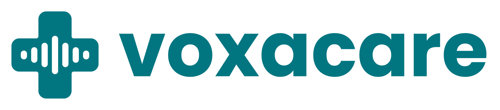

<p align="center"></p>

# Voxacare

Voice-to-record assistant for hospital care teams. Caregivers dictate at the bedside, an LLM turns the dictation into structured entries in the patient file, and an agent answers the team's questions with sources.

> WIP: student project (ECAM Brussels, AI course, 2026-2027). All patients and data are fictional. Not a medical device: the tool never diagnoses or decides, caregivers always validate.

## What works today
- **Patient file format**: Pydantic schema (treatments, instructions, entries, diagnoses, allergies, observation domains)
- **Dictation → patient file**: Mistral extracts structured entries from a free-text dictation
- **Doctor's questions**: an agent reads the files with tools and answers with citations, checked in code
- **Footprint tracking**: every LLM call is logged with tokens, latency, cost and estimated gCO2e (EcoLogits). Baseline: ~0.007 gCO2e for one dictation and three questions.

## Planned
- Observation domains per ward (psychiatry first), designed with field caregivers, for the whole care team (nursing, OT, physiotherapy, dietetics, social work)
- Per-patient summary sheet by observation domain, for multidisciplinary staff meetings (each professional writes their own report from it)
- Rule-based checks (dose given twice, drug not prescribed, open instruction not followed)
- Speech-to-text, benchmark and measured CO2 reduction

## Run it
```bash
python -m venv .venv && source .venv/bin/activate
pip install -r requirements.txt
echo "MISTRAL_API_KEY=your-key" > .env
python src/seed.py        # create fictional patients
python src/extraction.py  # a dictation becomes entries
python src/agent.py       # ask questions about the patients
```